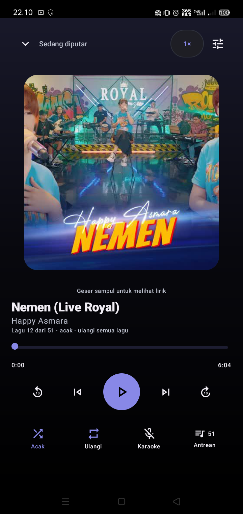
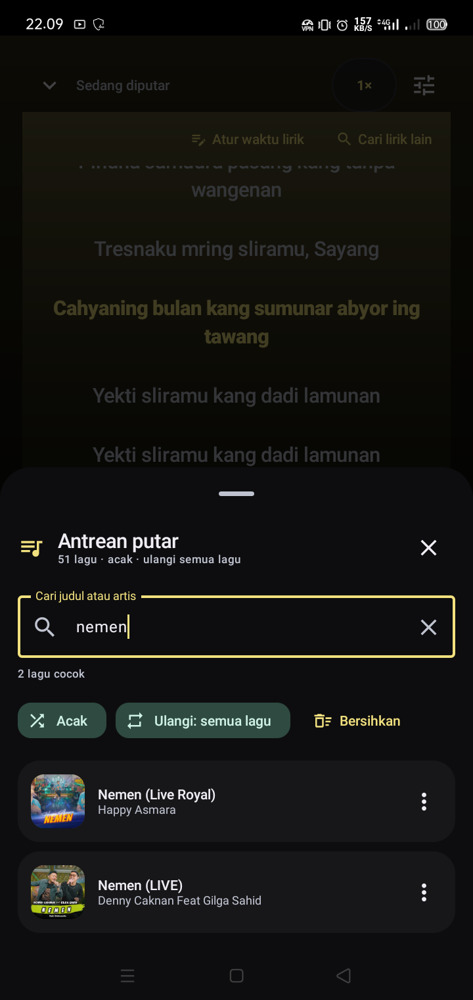
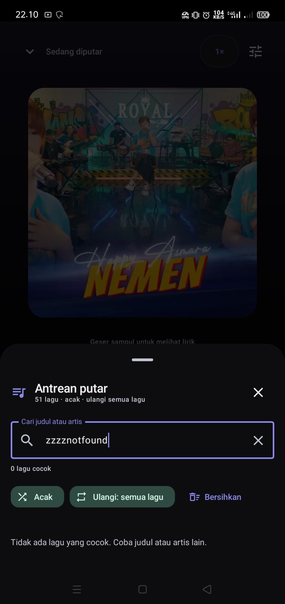

# Pemutar, pencarian antrean, dan auto-play 1.1.10

## Audit dan rencana sebelum implementasi

Slider Material3 default memakai track/thumb ekspresif yang terlalu besar untuk
player ini. Badge antrean berada di luar batas kontainer berbentuk pill, sehingga
jumlah terpotong. Antrean belum mempunyai filter lokal. Receiver manifest dan
runtime Bluetooth menggunakan status tidak diekspor; broadcast dari UID Bluetooth
tersendiri dapat ditolak. Receiver juga menyerahkan pemulihan async ke ViewModel
sebelum service hidup sehingga lifetime proses belum ditopang selama pembacaan Room.

Desain mengikuti Theme.kt: OLED #000000, surface #111113, teks #F0EDF4, sekunder
#BFC3D0, aksen fallback #C6B7FF serta aksen sampul dengan helper kontras. Mode terang
memakai peran tema yang sama. Spasi 4/8/12/16/24dp; radius sampul 24dp; hierarki
headlineSmall untuk lagu, labelSmall untuk aksi. Seek track 4dp/thumb12dp dengan
area sentuh tetap minimal48dp. Jumlah antrean ditempatkan di dalam tombol.

```text
[turun]       Sedang diputar       [speed] [EQ]
                 [sampul / lirik]
Judul lagu
Artis
────────────●───────────────────  track tipis
0:00                            durasi
    [−10] [sebelum] [PUTAR] [berikut] [+10]
    [acak] [ulangi] [karaoke] [ikon + jumlah]

Antrean putar / jumlah            [X]
[Cari judul atau artis                         ]
[acak] [ulangi] [bersihkan]
[sampul / lagu / artis / status / menu]
```

Kritik: hilangkan pelat sampul berlapis, bayangan besar dan pill dekoratif;
pertahankan aksen sebagai penunjuk kontrol dan lagu aktif. Pencarian mengacu ke
indeks antrean asli agar jump/move/remove hasil filter tidak menyasar lagu lain.
Pencarian tidak mengubah urutan atau membatasi pemutaran menjadi hasil filter.

Auto-play tetap memakai engine yang sama. Broadcast yang diterima dibatasi pada
action sistem terproteksi; service internal tetap tidak diekspor. Promosi foreground
mendahului pembacaan Room/fokus audio. Service dihentikan jika antrean kosong/gagal.
Batas Android tetap berlaku: HEADSET_PLUG kabel tidak membangunkan proses yang sudah
mati; force-stop dan pembatasan OEM bukan jaminan bisa ditembus. Jangan menambah
service pengawas permanen hanya untuk menutupi batas ini.

## Hasil

Implementasi **1.1.10 / versionCode24** selesai dan APK produksi terpasang
sebagai update di HP. Verifikasi terukur dan batas cakupan dicatat di bawah.

Sumber: [receiver Bluetooth](https://developer.android.com/develop/background-work/background-tasks/broadcasts),
[fokus audio](https://developer.android.com/media/optimize/audio-focus),
[batas foreground service](https://developer.android.com/develop/background-work/services/fgs/restrictions-bg-start).

## Keputusan setelah klarifikasi pengelola

Headset penguji adalah **kabel**, dengan pemicu **TubeFlow disapu dari Recent**.
Sesi media aktif kini memakai START_STICKY untuk meminta restart bila dihentikan
sistem; penanda `player-last/session_active` dibersihkan oleh X. Ini tidak
mengubah Room atau menambahkan database. Pemulihan tanpa output headset tetap
jeda; kecepatan diterapkan saat mulai putar setelah fokus audio, bukan saat
prepare karena PlaybackParams dapat memulai MediaPlayer. Jika proses benar-benar
mati, antrean disusun kembali dan posisi seek belum dipersist. Kebijakan OEM dan
force-stop tetap membatasi restart. TWS belum tersedia untuk uji fisik.

## Izin dan pemulihan

Bluetooth lama mendeklarasikan `BLUETOOTH` sampai API30. Android12+ mendeklarasikan
`BLUETOOTH_CONNECT` dan meminta izin hanya lewat tombol Auto-play Bluetooth di
Pengaturan; tersedia pula tautan pengaturan aplikasi untuk izin yang ditolak.
Tidak menambahkan BLUETOOTH_SCAN atau izin lokasi. Ini diperlukan selain exported:
[A2DP connection broadcast](https://developer.android.com/reference/android/bluetooth/BluetoothA2dp#ACTION_CONNECTION_STATE_CHANGED)
memerlukan izin penerimanya. Headset kabel tidak membutuhkan izin Bluetooth.

Regression host mencakup lima tes pencarian antrean serta empat tes manifest
(receiver exported, action terproteksi, service privat dan izin tanpa discovery).
Hasil suite akhir: **233 Kotlin, 83 Python**, tanpa kegagalan. Verifikasi rilis
dan HP tercatat di bawah; hasil host tidak menggantikan uji Bluetooth fisik.


## Verifikasi host dan artefak

- Perintah final: `JAVA_HOME=/usr/lib/jvm/java-17-openjdk-amd64 bash scripts/build_release.sh assembleDebug --offline --max-workers=2`.
  **BUILD SUCCESSFUL 4m19s**, termasuk testDebugUnitTest, lintDebug, lintRelease,
  assembleDebug, assembleRelease, bundleRelease dan R8 release.
- **233 Kotlin / 83 Python lulus**. Python: `python3 -m unittest discover -s scripts -p "test_*.py"`.
- Lint debug/release masing-masing **0 error, 2 warning**: SelectedPhotoAccess
  dan GradleDependency untuk pin ONNX1.23.2 yang disengaja. Peringatan compiler
  API MediaSession/Notification.Action serta deprecation Gradle tetap terpisah.
- APK ketiga ABI: signature, sertifikat, zipalign16KB, native alignment dan ZIP
  reflektif lulus. Native257/257/259 ELF; refleksi13kelas tanpa kegagalan.
  AAB: jarsigner, bundletool validate dan audit1.038 ELF lulus.
- Sertifikat produksi tetap `ebe3b40eb42c9b60fd044a011fc6a9e0cbfcde97c53accb2ea49934f4934dbd0`.
  Tidak menambah dependensi, mengubah Room9/schema, atau membuat keystore baru.

| Artefak | Byte | SHA256 |
| --- | ---: | --- |
| arm64-v8a APK | 70564491 | `3ff8b5a250a82b3e2aef65a1cf06f9ca2d7200e262b328418ea628e3b3f70d3a` |
| armeabi-v7a APK | 62254949 | `5fc03fd744070d9a38e09dbd50d5a5d4c82921687441007cb0ec7bdcd2721805` |
| x86_64 APK | 75005300 | `58000b3c3fa7386b0e07bf56e6eb93e0c97d2c2a946e0881e895f94b1c1d50f7` |
| AAB | 255593030 | `c4a7476bedc4a9a87035c342599a9b7670790b9ad764e0f08381be1705e29e48` |

ARM64 bertambah18.260byte dari1.1.9. Artefak aktif berada di
`app/build/outputs/apk/release/` dan `app/build/outputs/bundle/release/`;
tidak membuat salinan distribusi tambahan. Tidak mengukur benchmark RAM/baterai.

## Pengujian HP fisik — 15 Oktober 2026

Realme RMX1821, Android10/API29, ARM64, RAM4GB, halaman4KB, layar720×1520,
density272/font0,9. APK dipasang `adb install --no-incremental -r` tanpa uninstall,
reset atau clear-data; hash base.apk dari HP identik ARM64 di atas.

| Skenario | Hasil aktual |
| --- | --- |
| Pemutar penuh | Dialog memenuhi window; seekbar tipis, thumb kecil, empat aksi berlabel, jumlah51 terbaca utuh. |
| Pencarian antrean | `nemen` menghasilkan2lagu dari antrean51; query tanpa hasil menampilkan0 dan pesan yang jelas; clear mengembalikan daftar. |
| Pilih hasil filter | Nemen (Live Royal) / Happy Asmara diputar sebagai lagu12dari51, bukan posisi hasil pencarian; MediaSession sesuai. |
| Cabut-pasang kabel sesudah sapu Recent | Pengelola mengonfirmasi **“Langsung berjalan”** tanpa membuka TubeFlow. |
| Bukti sesi di latar | Log22:13:33 mencatat task removed,22:13:36/40 koneksi kabel; Launcher tetap foreground, MediaSession PLAYING dengan posisi1.095→3.108ms. |
| Integritas media | **70/70 file awal identik SHA256**, jumlah sesudah tes tetap70; tidak ada media dihapus/rename/reset. |
| Crash | Tidak ada nama package TubeFlow dalam buffer crash saat pemeriksaan. Ini bukan bukti seluruh skenario bebas crash. |

Musik dibiarkan berjalan setelah konfirmasi; preferensi acak/ulangi yang dipilih
pengelola dipertahankan. Bukti log rinci berada di direktori lokal diabaikan Git
`build/reports/player-1110/`; log perangkat mentah tidak dipublikasikan.





## Cakupan yang belum terbukti

- TWS/Bluetooth fisik, Android12+ (dialog izin, pembatasan foreground start dan
  notifikasi fallback), serta restart setelah proses benar-benar dimatikan OS.
  Tes Recent di atas membuktikan sesi bertahan, bukan simulasi process death.
- Force-stop, restart HP, dan pembatasan OEM agresif; auto-play bukan jaminan
  menembus kondisi tersebut. Seek belum disimpan saat proses mati.
- Mode terang versi ini, font1,3×/2×, lebar360dp, landscape/tablet, TalkBack dan
  runtime perangkat16KB. Tampilan gelap di atas tidak membuktikan matriks itu.
- Download jaringan audio/video baru, karaoke, storage penuh/izin SAF dicabut
  tidak dijalankan ulang di HP pada checkpoint ini. Suite host lulus.

## Pemeliharaan

File inti: `PlayerUi.kt`, `PlaybackQueueSearch.kt`, `HeadsetAutoPlayReceiver.kt`,
`PlaybackService.kt`, `PlayerViewModel.kt`, `SettingsScreen.kt`, manifest dan strings.
Regresi baru: `PlaybackQueueSearchTest.kt` (5) dan `test_playback_receivers.py` (4).
Jangan memakai indeks hasil filter untuk mutasi antrean; jangan memulai baca Room
atau meminta fokus audio sebelum bootstrap foreground. Pengujian selanjutnya yang
paling berguna adalah Android12+ dengan TWS dan izin Bluetooth aktif/nonaktif.
